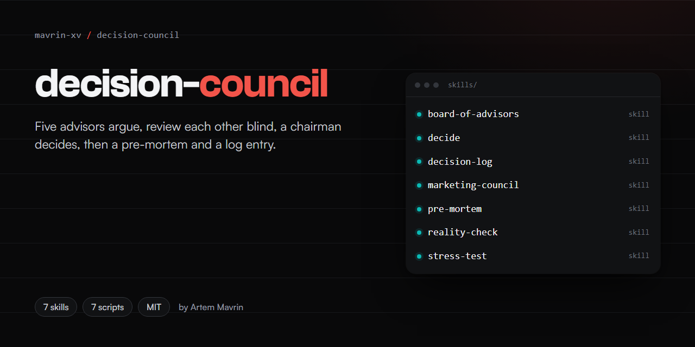
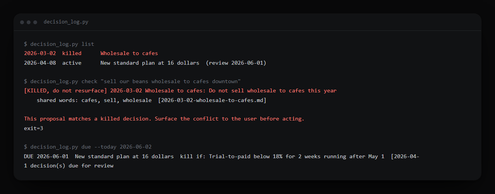

# decision-council

**One verdict you can act on for a business decision: five advisors argue, review each other blind, and a chairman decides, then the plan gets a pre-mortem, a stress test and a log entry.**

Asking one chat "should I do this?" gets you a polite yes. Asking five gets you five opinions and no decision.

[](LICENSE)




```bash
git clone https://github.com/mavrin-xv/decision-council && cd decision-council
./install.sh            # or: ./install.sh --project
```

<!-- install-notes:start -->
Other ways in: as a Claude Code plugin, run `/plugin marketplace add mavrin-xv/decision-council` and then `/plugin install decision-council@decision-council`. For Codex or another agent that reads `SKILL.md`, copy the folders under `skills/` into its skills directory. On Windows, run `install.sh` from Git Bash or WSL and type `py -3` where these docs say `python3`.
<!-- install-notes:end -->

Then in Claude Code: `/decide should we raise our subscription from $12 to $18?`

---

## What it solves

| Pain | What the pack does |
|---|---|
| The model agrees with whatever you proposed | Five advisors with opposed frames answer independently, before seeing each other |
| Long debates, no decision | Blind peer review with shuffled labels, then one chairman verdict with a kill criterion and a first step |
| Marketing plans judged by one lens | Eight specialists (positioning, offer, funnel, channels, copy, brand, data, community) on the same brief |
| Plans that fail for reasons everyone saw coming | Pre-mortem: "it is six months later and this failed, why?" with scored risks and tripwires |
| Pages and offers shipped with holes | Six personas read it as buyers, beginners, competitors; findings merged into SHIP / REVISE / REWORK |
| "It's done" with no proof | Reality check that defaults to NEEDS WORK until every must-have claim has evidence |
| The same dead idea comes back every quarter | Decision log that flags proposals matching a killed decision and lists decisions due for review |
| Running a 17-call council on a small question | A router that sizes the stakes and picks the cheapest method that fits |

## What's inside

| Skill | What it does | Say |
|---|---|---|
| `decide` | Sizes stakes, routes to the right methods, ends with one verdict | "help me decide", "should we", "is this a good idea" |
| `board-of-advisors` | Contrarian, First Principles, Expansionist, Outsider, Executor; blind review; chairman | "council this", "run the board", "war room this" |
| `marketing-council` | Eight marketing specialists, blind review, chairman with first channel and first test | "marketing council", "which channel", "how do we launch this" |
| `pre-mortem` | Plan mode: failure story, risk register, tripwires. Claim mode: doubt loop with a fresh reviewer | "pre-mortem this", "what could go wrong", "am I sure about this" |
| `stress-test` | Six personas attack an offer, page, brief or flow; merged findings and a ship verdict | "stress test this", "find the weak spots", "before we ship" |
| `reality-check` | Evidence gate for "done", "ready", "works" | "is it really ready", "reality check", "verify before launch" |
| `decision-log` | Plain-markdown log with kill criteria, review dates, and a killed-idea guard | "log this decision", "what did we decide about", "what is due" |

Each skill folder has `SKILL.md`, `references/` for the long parts, and one helper script. Slash commands live in `commands/`, blank inputs in `templates/`.

## Quick start

```text
/decide Northwind Roasters (2 people, 410 subscribers) wants to raise the
standard plan from $12 to $18 for new customers. Margin is 9% after
shipping went from $3.10 to $4.40. Competitors charge $15 and $17.
```

The router sizes it (high stakes, four moving parts), checks the log for killed ideas, runs the board, then a pre-mortem. Sample of the closing block from the bundled example:

```text
DECISION:    Do differently. New customers get 3 bags every 6 weeks for $16.
             Existing subscribers keep $12 until November 1.
WHY:         Margin is low because shipping per box rose, not because price is low.
MAIN RISK:   Trial-to-paid (24% today) falls and there is no ad budget to refill it.
FIRST STEP:  Email 10 current subscribers this week; quote a second courier.
KILL IF:     Trial-to-paid below 18% for 2 weeks running after May 1.
SPLIT:       Executor wanted a $16 vs $18 split test; too little traffic to settle it.
CONFIDENCE:  7/10
```

The whole run, with every script output, is in `examples/northwind-price-change/`. The business and its numbers are invented.

## How it works

```text
             your decision
                   |
            [decide] sizes stakes ---- low ----> doubt loop on one claim -> decide
                   |                                       
       decision-log check (killed before?) --- yes ---> ask: reopen?
                   |
        +----------+-----------+
        |                      |
 board-of-advisors     marketing-council
  5 frames, parallel    8 specialists, parallel
        |                      |
   council.py shuffle  (labels A..E, roles hidden)
        |
   blind reviewers: strongest, blind spot, what all missed, ranking
        |
   council.py tally  (where the room split)
        |
   chairman verdict: DECISION / WHY / MAIN RISK / FIRST STEP / KILL IF / CONFIDENCE
        |
   high stakes? -> pre-mortem (risk_register.py) -> doubt loop on the riskiest claim
        |
   artifact ready? -> stress-test (merge_findings.py) -> reality-check (evidence_check.py)
        |
   decision-log add (with review date)  ...  decision-log due (weeks later)
```

Three rules carry most of the weight. Advisors never see each other in round one, so the first answer does not anchor the rest. Reviewers see answers as A to E in random order, so they judge the argument and not the role. The chairman weighs arguments, not votes, and must name the split and what nobody covered.

Evidence labels (FACT, INTERNAL, CONVERGENCE, HYPOTHESIS) cap the confidence score: a verdict built on guesses cannot score high.

## Configure

| Setting | Where | Default |
|---|---|---|
| Decision log folder | `DECISION_LOG_DIR` env var or `--dir` | `./decisions` |
| Advisor frames | `skills/board-of-advisors/references/advisors.md` | five frames above |
| Marketing specialists | `skills/marketing-council/references/specialists.md` | eight lenses |
| Personas | `skills/stress-test/references/personas.md` | six, with domain swaps |
| Risk bands | `skills/pre-mortem/scripts/risk_register.py` | critical from score 15 |

Cross-model review is optional: pipe the reviewer packet to a second model's CLI and paste its JSON back. No API keys are needed by any script.

## Honest limits

- A council costs model calls: about 11 for the board and 17 for the marketing council (counted from the procedure, not measured). The router exists so you do not pay that on small questions.
- All advisors are usually the same model. Frames reduce agreement bias; they do not remove it. Use the cross-model option for decisions you cannot undo.
- The verdict is as good as the numbers in the brief. The skills ask for sources, but cannot check your spreadsheet.
- `decision_log.py check` matches keywords, so it misses paraphrases. The skill tells the agent to also read the brief and judge meaning.
- The bundled example's model outputs were written by hand to show the format. Script outputs in it are real runs.
- Tested with Claude Code. Other agents that read SKILL.md files should work; not tested.

## Credits

- Based on / inspired by https://github.com/karpathy/llm-council (no license file found; idea only, no code copied): parallel first opinions, anonymized peer ranking, chairman synthesis.
- Inspired by the five-advisor board popularised by Ole Lehmann and its open versions such as https://github.com/evisoft/council (no license file found; idea only): the five frames, random relabelling, "what did all of them miss".
- Doubt loop based on https://github.com/addyosmani/agent-skills (MIT): fresh-context reviewer that never sees the claim, three-loop cap.
- Reality check inspired by the Reality Checker agent in https://github.com/msitarzewski/agency-agents (MIT): default to NEEDS WORK, evidence over assertions.
- Pre-mortem from Gary Klein, "Performing a Project Premortem", Harvard Business Review, September 2007, https://hbr.org/2007/09/performing-a-project-premortem.
- Multi-agent debate background: Du et al., "Improving Factuality and Reasoning in Language Models through Multiagent Debate", https://arxiv.org/abs/2305.14325.

## Contributing

See `CONTRIBUTING.md`. Coding agents should read `AGENTS.md` first.

<!-- author:start -->
## Author

Built and maintained by [Artem Mavrin](https://github.com/mavrin-xv). This repo is one of a set of agent skill packs for marketing and operations work. Each one installs on its own; the full list is in [agent-skill-packs](https://github.com/mavrin-xv/agent-skill-packs). If a pack saved you an afternoon, a star helps other people find it.
<!-- author:end -->

## License

MIT, see `LICENSE`.
